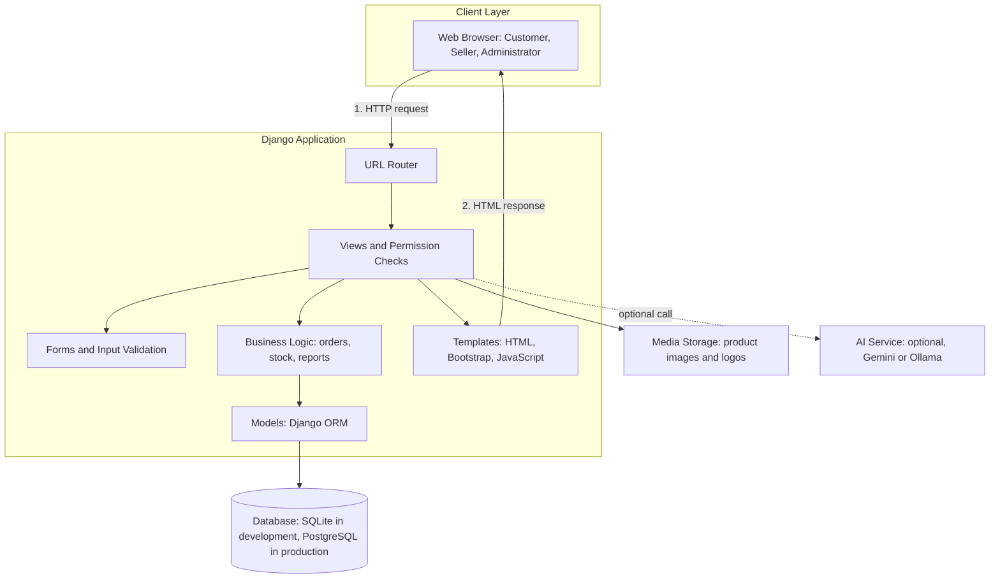

# System Architecture: MarketFlow

## 1. Architecture Diagram

## 2. Layers and Their Purpose

| Layer | Django part | Purpose |
|---|---|---|
| Presentation | Templates | Shows pages to the user |
| Routing | URL router | Sends each web address to the correct view |
| Control | Views | Receives the request, checks permissions, and returns a response |
| Validation | Forms | Checks user input before it is saved |
| Business logic | Service functions | Holds the rules: stock check, price calculation, order splitting |
| Data access | Models (ORM) | Reads and writes the database |
| Storage | Database and media files | Keeps data and uploaded images |
| External | AI service | Optional helper for descriptions and discovery |

## 3. Django Apps

| App | Responsibility |
|---|---|
| accounts | Users, roles, login, registration |
| shops | Shop profiles |
| catalog | Categories, products, images, CSV import |
| cart | Shopping cart |
| orders | Orders, order items, status workflow, stock deduction |
| payments | Payment records |
| delivery | Delivery and tracking |
| reviews | Ratings and reviews |
| reports | Sales reports and analytics |
| ai_assistant | AI description generator and discovery helper |

## 4. Example Request Flow: Seller Confirms an Order

1. The seller clicks **Confirm** in the browser.
2. The URL router sends the request to the order-confirm view.
3. The view checks that the user is a seller **and** that the order belongs to their own shop.
4. The business logic checks that there is enough stock.
5. The model reduces the stock and changes the order status, inside one database transaction.
6. The template shows the updated order page with a success message.

## 5. Design Principles Applied

- **Separation of concerns:** each app has one responsibility.
- **Server-side security:** permissions and calculations are done on the server, never trusted from the browser.
- **Graceful degradation:** if the AI service fails, the rest of the system keeps working.
- **Transactions:** order creation and stock changes either fully succeed or are fully undone.