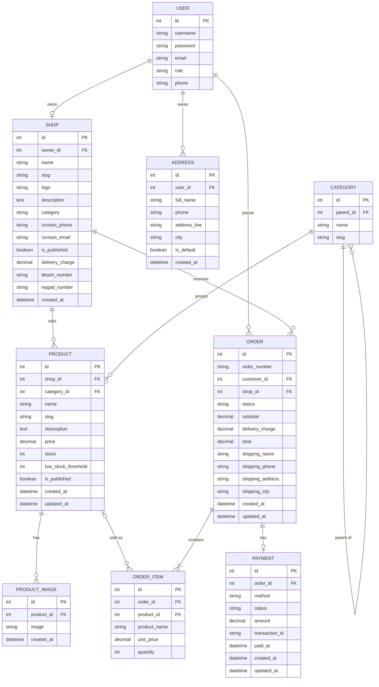
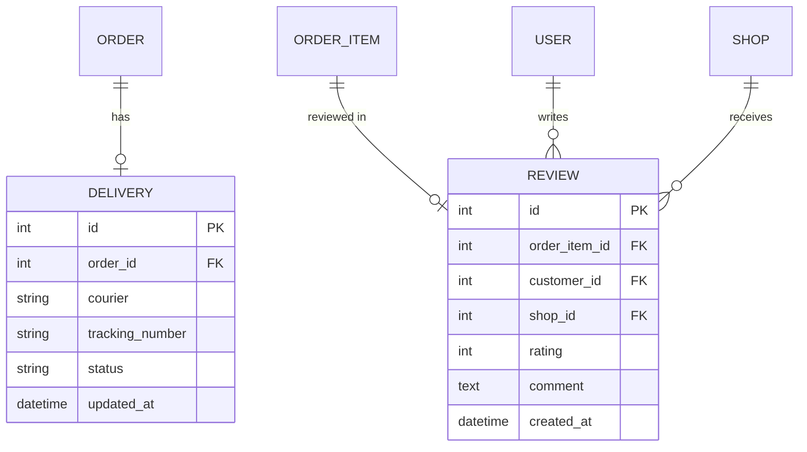

# ER Diagram: MarketFlow

This diagram shows the database tables that exist in the current version of the system.

## Planned Tables

These tables belong to later phases and do not exist yet.

## Design Notes

| Topic | Decision |
|---|---|
| Shopping cart | Stored in the visitor's session, not in a table, so customers can shop before logging in |
| Order snapshots | OrderItem keeps the product name and unit price; Order keeps the delivery charge, totals, and shipping details. Old orders never change when prices or addresses change. |
| One order per shop | A cart with items from several shops creates one Order (with its own Payment) for each shop |
| Separate statuses | Order status, payment status, and (planned) delivery status are stored separately |
| Protected records | A customer or shop that has orders cannot be deleted (PROTECT) |
| Product links | OrderItem.product is set to empty if a product is deleted; the copied name and price remain |
| Payment | One Payment per Order. A transaction ID can be used only once per method. |