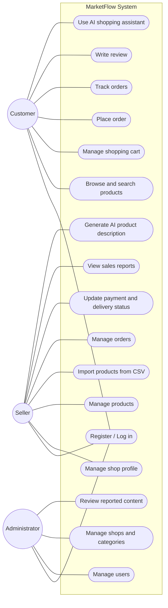

# Use-Case Diagram: MarketFlow

## Actor Descriptions

| Actor | Description |
|---|---|
| Customer | Browses products, places orders, tracks deliveries, and writes reviews |
| Seller | Manages one shop, its products, orders, and sales reports |
| Administrator | Manages users, shops, categories, and reported content |